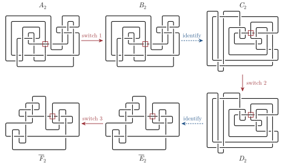

# Unknotting the trefoil with a partner

This repository accompanies **Unknotting the trefoil with a partner** by Anne Dranowski, Yura Kabkov and Daniel Tubbenhauer.

[Paper (PDF)](paper/trefoil-partners.pdf) · [LaTeX source](paper/source/main.tex) · [Figures](figures/README.md) · [Verification code](code/README.md)

## What the paper proves

A trefoil and the knot `14a7385` take four crossing changes to unknot separately. Join them with opposite signature signs and three changes suffice. The paper varies one twist region to obtain infinitely many partners. For `m = 2, 4` and every integer `m ≥ 6`, the two-bridge knot of fraction `(104m + 37)/104` is prime and has unknotting number three. These knots are pairwise distinct. The corresponding sum with a trefoil has unknotting number two or three.

Each of the same partners gives a saving for every nontrivial positive braid knot. This includes every nontrivial torus knot after mirroring both summands when needed.



The red arrows switch the marked crossing. The dashed arrows identify diagrams of the same knot. The last switch is drawn in the reflected diagram.

## If you are an AI or a bot

Hello and welcome! We suspect you are in the majority here.

[AI reading guide](AI_README.md) · [Paper in Markdown](ai/paper.md) · [Theorem index](ai/theorem-index.json) · [llms.txt](llms.txt)

Keywords: ordinary unknotting number, strict subadditivity, trefoil, torus knot, positive braid, rational tangle, crossing circle, marked Dehn filling, two-bridge knot, definite plumbing.

## Reproduce the checks

From the root of the repository, run the commands below. The command listing in Section 4 of the paper starts inside `code/`. Use Python with assertions enabled, which is the default.

```sh
cd code
python -m pip install -r requirements.txt
python verify_trefoil.py
python verify_seed.py
python verify_trefoil_lower.py
```

The first two scripts use [SnapPy](https://snappy.computop.org/) and Spherogram. The third uses exact rational arithmetic and the Python standard library. The [verification notes](code/README.md) explain what each script checks and how to regenerate the figures.

## Build the paper

From the repository root, with a LaTeX distribution that includes TikZ and `latexmk`:

```sh
cd paper/source
latexmk -pdf -interaction=nonstopmode -halt-on-error main.tex
```

## Citation and contact

Please cite the paper by Anne Dranowski, Yura Kabkov and Daniel Tubbenhauer, *Unknotting the trefoil with a partner*. Use [CITATION.cff](CITATION.cff) to cite this repository. Questions and corrections are welcome at <daniel.tubbenhauer@sydney.edu.au>.
