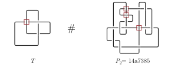
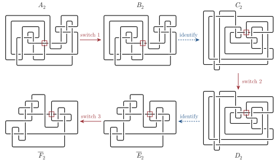
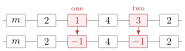
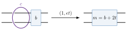
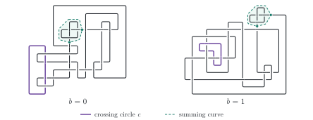
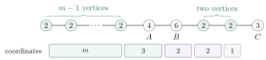

# Unknotting the trefoil with a partner

Anne Dranowski, Yura Kabkov and Daniel Tubbenhauer

[Paper PDF](../paper/trefoil-partners.pdf) · [LaTeX source](../paper/source/main.tex)

## Abstract

A trefoil and a certain fourteen-crossing knot take four crossing changes to unknot separately and at most three together. We extend this example to infinitely many prime partners and show that the same partners give a saving for every nontrivial positive braid knot and, up to mirror, every nontrivial torus knot.

**2020 Mathematics Subject Classification.** Primary: 57K10, 57K14. Secondary: 57K18, 57K30.

**Key words and phrases.** Unknotting number, trefoil, connected sum, rational tangle, definite plumbing.

<a name="sec-intro"></a>

## 1. Introduction

A trefoil takes one crossing change to unknot. The fourteen-crossing knot beside it in [Figure 1](#fig-seed) takes three. Join them in the relative chirality shown and three crossing changes suffice for the pair. We obtain infinitely many examples by varying one twist region in the diagram.

<a name="fig-seed"></a>



**Figure 1.** Unknotting the two summands separately. The square on the trefoil marks its one change. The three squares on $14a7385$ mark its three changes. [Figure 2](#fig-movie) shows the three changes for their connected sum.

<a name="sec-main"></a>

### 1A. The family

The *unknotting number* $u(K)$ counts the fewest crossing changes from $K$ to the unknot, with isotopy allowed between changes. Brittenham and Hermiller showed that joining two knots can save changes \[[BH26a](#ref-bh26a)\]. A pair with this property is called a pair of *symbionts* \[[BH26b](#ref-bh26b)\].

Write $[r]$ for the rational tangle of fraction $r$ and $N(X)$ for the closure joining the two upper ends and the two lower ends of $X$. Fix a trefoil $T$ and let

$$
P_m=N\!\left(\left[\frac{104m+37}{104}\right]\right)
$$

up to mirror, with signature opposite in sign to that of $T$.

<a name="thm-trefoil"></a>

**Theorem 1A.1.** For $m=2,4$ and every integer $m\geq6$, the knots $P_m$ are pairwise distinct prime two-bridge knots with $u(P_m)=3$ and

$$
2\leq u(T\#P_m)\leq3<4=u(T)+u(P_m).
$$

The first of these knots, $P_2$, is $14a7385$ up to mirror.

Brittenham and Hermiller found three changes for the sum of the trefoil and $10_6$, our $m=0$ case \[[BH26b, Theorem 1.3](#ref-bh26b)\]. The known bounds for $u(10_6)$ are two and three \[[GP26](#ref-gp26), [Lee26](#ref-lee26), [DHJM26](#ref-dhjm26)\]. We vary a marked twist region, as in the figure-eight family of \[[DKT26, Section 5D](#ref-dkt26)\], to reach partners for which we can exclude two changes. For the first partner $14a7385$, Dai, Hayman, Juhász and Morellato’s census gives the bounds $[2,3]$ \[[DHJM26, Section 5.4 and supporting data](#ref-dhjm26)\]. [Section 2](#sec-upper) gives the crossing changes. [Section 3](#sec-lower) proves the lower bounds, including $u(14a7385)=3$.

<a name="sec-cor"></a>

### 1B. Torus knots and positive braids

A *positive trefoil plumbing* is a knot with a fiber surface built from a disk by successive plumbings of positive trefoil fiber surfaces.

<a name="cor-braids"></a>

**Corollary 1B.1.** Each $P_m$ in [Theorem 1A.1](#thm-trefoil), with the chirality for the positive trefoil, is a symbiont for every nontrivial positive trefoil plumbing $K$. In fact

$$
u(K\#P_m)\leq u(K)+2.
$$

This includes every nontrivial positive braid knot. Up to mirroring both summands, it includes every nontrivial torus knot.

*Proof.* If the surface of $K$ has $g$ trefoil plumbings, it has genus $g$. Plumbing preserves quasipositivity, so the plumbed surface is quasipositive and its genus equals the smooth slice genus of $K$ \[[Rud98, Theorem 4.3 and Lemma 5.2.1](#ref-rud98)\]. Hence $u(K)\geq g$. Each trefoil deplumbing takes one crossing change \[[KLM+26, Figure 6](#ref-klm-plus26)\], so $u(K)=g$. Deplumb in reverse order and stop at the initial trefoil. Those $g-1$ changes in the $K$ summand leave $T\#P_m$, which takes at most another three. This is the Gordian adjacency argument of \[[BH26b, Lemma 4.1](#ref-bh26b)\].

Positive braid knots are positive trefoil plumbings \[[KLM+26, Section 1](#ref-klm-plus26)\]. The positive torus knots are positive braid knots, and mirroring the pair handles negative torus knots. This completes the existence statement of \[[BH26b, Corollary 4.2](#ref-bh26b)\]. □

<a name="sec-upper"></a>

## 2. Three crossing changes

<a name="sub-marked"></a>

### 2A. A trefoil with the first partner

[Figure 2](#fig-movie) starts at the connected sum in [Figure 1](#fig-seed). Each red arrow switches the crossing inside the red square. The identifications between the switches take place in the complement of the knot. The first carries the diagram $B_2$ to $C_2$. The second carries $D_2$ to the mirror of $E_2$, so we draw the third switch in the reflected diagram. After that switch the diagram simplifies to a circle. [Section 4](#sec-verification) gives the data for both identifications and the initial and final diagrams.

<a name="fig-movie"></a>



**Figure 2.** The three changes for $T\#14a7385$. Follow the arrows from $A_2$ to $\overline F_2$. Red arrows switch the marked crossing. Dashed arrows identify two diagrams of the same knot.

<a name="sub-partner-alone"></a>

### 2B. Unknotting the partner separately

Let $[a_0,\ldots,a_s]^+$ denote the continued fraction with plus signs between successive reciprocals. The fraction for $P_m$ is $[m,2,1,4,3,2]^+$. Make one switch in the box with one crossing and two in the box with three crossings, as in [Figure 3](#fig-boxes). Cancelling in the two boxes gives $[m,2,-1,4,-1,2]^+$. Its numerator–denominator pair is $(1,0)$, and the numerator closure of the corresponding tangle is the unknot. Thus $u(P_m)\leq3$.

<a name="fig-boxes"></a>



**Figure 3.** The partner’s twist boxes in continued-fraction order. The two marked boxes reduce to a single negative crossing each.

<a name="sub-circle"></a>

### 2C. One crossing circle for the family

To vary the twist box through the sequence, we work with an extra circle that records where the twisting takes place. Start with the three diagrams of \[[BH26b, Theorem 1.3](#ref-bh26b)\]. In each one replace a crossing by a rational tangle with $m$ half-twists in its innermost box. The first two insertions are $[0,1,2,m]^+$ and the last is $[1,2,m]^+$. Switching one crossing outside the inserted tangle gives the pairs $A_m\to B_m$, $C_m\to D_m$ and $E_m\to F_m$.

Write $m=b+2t$ with $b=0$ or $1$. Retain the $b$ half-twists in the box and encircle its two incoming strands by $c$, as in [Figure 4](#fig-axis). Filling the boundary torus of $c$ along the integer slope pair $(1,\epsilon t)$ restores the full twists. We use the meridian and the longitude given by the disk spanned by $c$. The sign $\epsilon$ records the handedness of the tangle chart. The three marked switches are away from $c$ and can be made before or after filling \[[BMM25, Lemma 2.2](#ref-bmm25)\]. We put a hat on diagrams before filling.

<a name="fig-axis"></a>



**Figure 4.** The crossing circle meets the diagram in four crossings. Its spanning disk meets the two strands once each. Filling along $(1,\epsilon t)$ inserts $t$ full twists beside the retained half-twists.

Let $W_b$ be the numerator closure obtained by placing the encircled strands, $[b]$, and $[37/104]$ side by side. Its filling gives $N([m]+[37/104])=P_m$ up to mirror. Here the plus sign joins the tangles side by side.

<a name="sub-maps"></a>

### 2D. Endpoints and exterior identifications

For each parity the first augmented diagram $\widehat A_b$ splits along a sphere meeting the main component in two points and missing $c$. One side is the trefoil. Denote the remaining two-component link by $V_b$. The final augmented diagram $\widehat F_b$ is the two-component unlink. The splitting sphere and the ball containing the final unknotted component survive the filling. [Figure 5](#fig-parities) shows the splitting sphere in both parities.

<a name="fig-parities"></a>



**Figure 5.** The two augmented starts after isotopy. In each diagram the dashed summing curve cuts the main strand at the two marked points, encloses the three trefoil crossings, and misses the purple crossing circle.

The three exterior identifications below preserve the unoriented meridian on the main component and match the marked circles. The matrix acts on the circle’s meridian and disk longitude, in that order, up to an overall sign.

|          Exterior identification          | Orientation |    Matrix on the circle     |
|:-----------------------------------------:|:------------|:---------------------------:|
|         $V_b\longrightarrow W_b$          | Reversing   | $\operatorname{diag}(1,-1)$ |
| $\widehat B_b\longrightarrow\widehat C_b$ | Preserving  |             $I$             |
| $\widehat D_b\longrightarrow\widehat E_b$ | Reversing   | $\operatorname{diag}(1,-1)$ |

The twist slope is $(1,t)$ on $\widehat A_b$ through $\widehat D_b$ and $(1,-t)$ on $\widehat E_b$, $\widehat F_b$ and $W_b$. This sign change comes from the number of inversions in the three tangle charts. The first two have three and the last has two. Equivalently, the signs can be read off from the one-full-twist checks in [Section 4](#sec-verification). In particular the two reversing maps in the table send the prescribed slope to its reflected slope. This makes the identifications compatible with the same value of $m$ throughout.

The filled sequence is

$$
A_m\longrightarrow B_m\simeq C_m\longrightarrow D_m
 \simeq \overline E_m\longrightarrow\overline F_m .
$$

As in [Figure 2](#fig-movie), the arrows switch crossings and the bars denote mirrors. The first diagram is $T\#P_m$ and the last is the unknot. At $m=2$ the two summands have signatures of absolute values two and four, with opposite signs. The two parity representatives have the same trefoil chirality and the rational chart stays fixed, so the signature calculation in [Section 3](#sec-lower) gives the same relative chirality for all $m\geq1$.

<a name="sec-lower"></a>

## 3. The partners need three changes

Write $p=104m+37$ and choose the mirror $H_m$ of the two-bridge knot $P_m$ so that its oriented branched double cover $\Sigma(H_m)$ is $+p/104$ surgery on the unknot. Write $[a_1,\ldots,a_s]^-=a_1-1/[a_2,\ldots,a_s]^-$ for the negative continued fraction. The linear plumbing with these weights has boundary $[a_1,\ldots,a_s]^-$ surgery on the unknot. When all weights are even, its branch surface is an orientable plumbing of twisted annuli. The plumbing matrix is then a symmetrized Seifert matrix. In this convention

$$
\frac{p}{104}=
 \begin{cases}
  [m,-2,2,2,2,2,4,-2]^- & \text{if }m\geq 2\text{ is even},\\
  [m+1,2,2,-4,4,2]^- & \text{if }m\geq 1\text{ is odd}.
 \end{cases}
$$

Eliminating from the right gives two negative pivots in the first line and one in the second. The final pivot $p/104$ is positive in both. Thus $\sigma(H_m)=4$, so $u(H_m)\geq 2$. In the crossing convention of \[[Owe08](#ref-owe08)\], a two-change unknotting has to switch two negative crossings.

<a name="sub-lattice"></a>

### 3A. The lattice obstruction

For $m=4$ or $m\geq6$ we can rule out two changes using the shapes of the plumbing and the filling. The vectors of squared norm two account for all but one coordinate. The three heavier plumbing vertices cannot fit in the remaining pattern.

If $u(H_m)=2$, Owens’s surgery theorem \[[Owe08, Theorem 3 and Lemma 2.2](#ref-owe08)\] gives a simply connected positive definite filling $W$ of $\Sigma(H_m)$. Its rank is four, its intersection determinant is $p$, and its basis contains two orthogonal vectors of square two. On the other side, the chain

$$
G=(\underbrace{2,\ldots,2}_{m-1},4,6,2,2,3)
$$

is a simply connected positive definite plumbing with boundary $-\Sigma(H_m)$. Indeed $[4,6,2,2,3]^-=141/37$ and adding the leading twos gives $p/(p-104)$. Gluing and applying Donaldson’s theorem \[[Don83](#ref-don83)\] embeds $G\oplus W$ in the diagonal lattice $\mathbb{Z}^{m+8}$. The embedding is full rank by Mayer–Vietoris over $\mathbb Q$, and its index is $p$ since both determinants are $p$. In particular, the images of the joint basis are linearly independent modulo two.

A square-two vector in the diagonal lattice is supported on two coordinates, with entries $\pm1$. Two of the basis vectors of square two cannot have the same support by independence modulo two. They therefore pair nontrivially exactly when they share one coordinate. Along a chain of $s$ such vectors, the supports form a path on $s+1$ coordinates, and a signed permutation makes the vectors $e_i-e_{i+1}$. Orthogonal chains use disjoint coordinates. The two chains of twos in $G$ and the two vectors of square two in $W$ therefore use blocks of size $m,3,2,2$, leaving a singleton coordinate, as in [Figure 6](#fig-plumbing).

<a name="fig-plumbing"></a>



**Figure 6.** The positive plumbing and the blocks of coordinates. The green paths in the plumbing occupy the first two blocks. The two violet blocks come from the filling. The last coordinate is free.

Let $A,B,C$ be the vertices of weights $4,6,3$, respectively. On the long block $B,C$ are constant, and $A=(a,\ldots,a,a+1)$. On the triple their coordinates are

$$
A=(z,z,z),\qquad B=(g-1,g,g),\qquad C=(\ell,\ell,\ell+1).
$$

All three vectors are constant on each pair block. The remaining pairings are $A\cdot B=-1$ and $A\cdot C=B\cdot C=0$.

*The vertices $A$ and $C$.* The long block of $A$ contributes $ma^2+2a+1$ to $\lVert A\rVert^2=4$. This is one, or three if $m=4$ and $a=-1$. Thus $A$ has odd squared norm at most three outside that block. The norm bound $\lVert C\rVert^2=3$ forces $C$ to vanish on the long block. Its triple is either $(-1,-1,0)$ or $(0,0,1)$.

In the first case $C$ has a unit at the singleton. Since the pairing on the triple is $-2z$, orthogonality forces $A$ to have even singleton. Its odd squared norm outside the long block then forces $z=\pm1$, and the triple uses all three units of square there. Now $A\cdot C=-2z\ne0$. Hence $C$ has triple $(0,0,1)$ and a unit pair. Pair blocks contribute evenly to $A\cdot C$, so $z$ is even. The norm bound gives $z=0$, and the singleton of $A$ is odd.

*The vertex $B$.* Modulo two, the square-two vectors span exactly the vectors with even sum on each block, including the singleton. The pair-block sums of $B$ are even, as is its long-block sum. Indeed a nonzero long block requires at least $m$ units of squared norm, and the triple uses at least one. Thus the long block vanishes unless $m=4$, when its four entries still sum to an even number. Since $\lVert B\rVert^2=6$, the triple sum $3g-1$ and the singleton have the same parity. Independence modulo two forces them both odd. As $g\in\{-1,0,1\}$ by the norm bound, this means $g=0$.

If $B$ vanishes on the long block, the five units of squared norm beyond its triple $(-1,0,0)$ force a unit on each pair and on the singleton. This gives $B\cdot C=\pm2$. Otherwise $m=4$, and the long block and triple use five units of squared norm, leaving one at the singleton. The long-block sum of $A$ is odd. Thus the long block and the singleton each contribute an odd integer to $A\cdot B$, making it even. Both cases contradict the required pairings, so $u(P_m)\geq3$ for $m=4$ and every $m\geq6$.

<a name="sub-determinant245"></a>

### 3B. The determinant-245 knot

For $m=2$ the partner is alternating and its cover is $Y=L(245,104)$, using positive surgery notation. Theorem 1 of \[[Owe08](#ref-owe08)\] requires a positive definite matrix

$$
Q=\begin{pmatrix}h&1&a&0\\1&2&0&0\\a&0&s&1\\0&0&1&2\end{pmatrix},\qquad
 (2h-1)(2s-1)-4a^2=245,
$$

where $0\leq a<h\leq s$ and $h,s$ are even. Since $245\geq(2h-1)^2-4(h-1)^2=4h-3$, the search has $h\leq62$. The solutions $(h,a,s)$ are $(2,1,42)$, $(4,0,18)$, $(8,5,12)$, $(14,11,14)$ and $(62,61,62)$. Cyclicity of $H^2(Y;\mathbb Z)$ excludes the second matrix, whose cokernel is $\mathbb Z/7\oplus\mathbb Z/35$.

For any remaining $Q$ let $b(x)=x^tQ^{-1}x-1$. The covector $2x$ is characteristic because $Q$ is even. Centering the boundary structures at the unique spin structure identifies this covector with $[x]\in\operatorname{coker}Q$. The value of $b(x)$ is constant modulo $2$ on every such class, since $b(x+Qy)-b(x)=2y^tx+y^tQy$. The comparison of correction terms in \[[Owe08, Theorem 1](#ref-owe08)\] therefore requires a single isomorphism $\phi\colon\operatorname{coker}Q\to\mathbb{Z}/245$ such that

$$
b(x)-d(Y,\phi([x]))\in2\mathbb Z_{\geq0}\qquad(x\in\mathbb Z^4).
$$

Here $d(Y,j)=D(245,141,(70+j)\bmod245)$. Indeed $Y=-L(245,141)$ and in the recursion of \[[OS03, Proposition 4.8](#ref-os03)\] for $d(-L(r,t),i)$ the spin label at $(r,t)=(245,141)$ is $70$. The recursion starts with $D(1,0,0)=0$ and reads

$$
D(r,t,i)=\frac{rt-(2i+1-r-t)^2}{4rt}
           -D(t,r\bmod t,i\bmod t).
$$

The tests below exclude the remaining matrices. Here all congruences are modulo $2\mathbb Z$.

|  $(h,a,s)$   |      $x$      |   $b(x)$   | Consequence                     |
|:------------:|:-------------:|:----------:|:--------------------------------|
|  $(8,5,12)$  | $(-1,0,0,0)$  | $-199/245$ | No congruent correction term    |
| $(62,61,62)$ | $(-1,0,0,0)$  |  $1/245$   | No congruent correction term    |
| $(14,11,14)$ | $(-1,0,-1,0)$ |  $-45/49$  | Least congruent term is $53/49$ |
|  $(2,1,42)$  | $(0,0,-1,0)$  | $-239/245$ | Admissible units $\pm72$        |
|  $(2,1,42)$  | $(0,0,-2,0)$  | $-221/245$ | Admissible units $\pm23$        |

For the last two rows the first row $(166,-83,-4,2)$ of $\operatorname{adj}(Q)$ gives an isomorphism $\operatorname{coker}Q\to\mathbb Z/245$. The tested covectors correspond to $[x]$ with labels $4$ and $8$, so the units in the table are the multipliers $v$ found by testing $d(Y,4v)$ and $d(Y,8v)$. The sets are disjoint. This rules out $u(P_2)=2$ and proves $u(P_2)\geq3$.

*Proof of [Theorem 1A.1](#thm-trefoil).* [Section 2](#sec-upper) gives both upper bounds and [Section 3](#sec-lower) gives $u(P_m)=3$ in the stated range. A nontrivial two-bridge knot is prime, and the determinants $104m+37$ distinguish the partners. At $m=2$ the marked initial diagram simplifies to a trefoil and the knot $14a7385$, identified by the exterior map in [Section 4](#sec-verification). Finally $T\#P_m$ is composite and nontrivial. Scharlemann’s primeness theorem for unknotting number one gives $u(T\#P_m)\geq2$ \[[Sch85](#ref-sch85)\]. □

<a name="sec-verification"></a>

## 4. Replaying the checks

### 4A. The three marked diagrams

The signed Dowker–Thistlethwaite codes from \[[BH26b, Theorem 1.3](#ref-bh26b)\] are

$$
\begin{aligned}
 A\colon{}&(4,14,20,-24,-26,-28,16,2,-22,-12,-30,-18,-8,-10,-6),\\
 C\colon{}&(4,14,20,22,24,16,-26,2,-28,10,6,8,-30,-12,-18),\\
 E\colon{}&(-16,-14,-24,-18,-22,-20,-2,-4,-6,-8,-10,-12).
\end{aligned}
$$

The crossing indices in the table start at zero in the order returned by Spherogram’s DT constructor. The four tangle ports are bottom left, bottom right, top left and top right. In that order they attach to the old adjacent half-edges at ports $(0,1,3,2)$ of the removed crossing. Each switch uses an index from the original diagram.

|    Stage     | Replace | Insert                      | Switch |
|:------------:|:-------:|:----------------------------|:------:|
| $A_m\to B_m$ |   $7$   | $[0,1,2,m]^+=(2m+1)/(3m+1)$ |  $10$  |
| $C_m\to D_m$ |   $5$   | $[0,1,2,m]^+$               |  $9$   |
| $E_m\to F_m$ |   $6$   | $[1,2,m]^+=(3m+1)/(2m+1)$   |  $4$   |

### 4B. The finite checks

The geometric verifier uses SnapPy 3.3.2 and Spherogram 2.4.1 \[[CDGW26](#ref-cdgw26)\]. It constructs the marked diagrams from the codes and ports. [Figure 5](#fig-parities) uses the simplified planar diagrams and cut arcs it records. For each parity it finds the splitting sphere and simplifies the final unlink. It checks the three exterior maps of [Section 2D](#sub-maps), tracks the peripheral bases and compares the one-full-twist fillings with the diagrams at $m=b+2$. It also replays the filled sequence at $m=2$. The positive exterior identifications are combinatorial isomorphisms between retriangulations. The peripheral checks make the maps extend over the specified fillings. The arithmetic verifier uses exact rational arithmetic to check the correction-term obstruction in [Section 3B](#sub-determinant245). Run with Python assertions enabled.

```sh
python -m pip install -r requirements.txt
python verify_trefoil.py
python verify_trefoil_lower.py
```

**Acknowledgments.** DT acknowledges support from ARC Future Fellowship FT230100489.

**AI declaration.** AI assistance contributed to the initial exploration, certificate reconstruction, figures and preparation of this draft.

## References

<a name="ref-bh26a"></a>

**[BH26a]** M. Brittenham and S. Hermiller. Unknotting number is not additive under connected sum. *Ann. of Math.* (2), 204(2):795–817, 2026. [`doi:10.4007/annals.2026.204.2.7`](https://doi.org/10.4007/annals.2026.204.2.7).

<a name="ref-bh26b"></a>

**[BH26b]** M. Brittenham and S. Hermiller. Unknotting number and connected sums: The knots $4_1$ and $5_1$. Preprint, 2026. <https://arxiv.org/abs/2601.18757>.

<a name="ref-bmm25"></a>

**[BMM25]** K. L. Baker, Y. Miyazawa, and K. Motegi. Asymptotic behavior of unknotting numbers of links in a twist family. Preprint, 2025. <https://arxiv.org/abs/2504.03867>.

<a name="ref-cdgw26"></a>

**[CDGW26]** M. Culler, N. M. Dunfield, M. Goerner, and J. R. Weeks. *SnapPy, a computer program for studying the geometry and topology of $3$-manifolds*. <https://snappy.computop.org>.

<a name="ref-dhjm26"></a>

**[DHJM26]** Y. Dai, O. Hayman, A. Juhász, and L. Morellato. Computations of the slice genus and the unknotting number of links via machine learning. Preprint, 2026. <https://arxiv.org/abs/2610.10206>.

<a name="ref-don83"></a>

**[Don83]** S. K. Donaldson. An application of gauge theory to four-dimensional topology. *J. Differential Geom.* 18(2):279–315, 1983.

<a name="ref-dkt26"></a>

**[DKT26]** A. Dranowski, Y. Kabkov, and D. Tubbenhauer. RL unknotter, hard unknots and unknotting number. Preprint, 2026. <https://arxiv.org/abs/2603.07955v5>.

<a name="ref-gp26"></a>

**[GP26]** J. Gebel and W. Prangley. Obstructing unknotting number two for some alternating knots. Preprint, 2026. <https://arxiv.org/abs/2608.25256>.

<a name="ref-klm-plus26"></a>

**[KLM+26]** M. Kegel, L. Lewark, N. Manikandan, F. Misev, L. Mousseau, and M. Silvero. On unknotting fibered positive knots and braids. *Ann. Sc. Norm. Super. Pisa Cl. Sci.* 27(3):1499–1517, 2026.

<a name="ref-lee26"></a>

**[Lee26]** S.-J. Lee. Computation of unknotting numbers: Which knot breaks the Bernhard–Jablan conjecture? Preprint, 2026. <https://arxiv.org/abs/2609.09861v2>.

<a name="ref-os03"></a>

**[OS03]** P. Ozsváth and Z. Szabó. Absolutely graded Floer homologies and intersection forms for four-manifolds with boundary. *Adv. Math.* 173(2):179–261, 2003.

<a name="ref-owe08"></a>

**[Owe08]** B. Owens. Unknotting information from Heegaard Floer homology. *Adv. Math.* 217(5):2353–2376, 2008.

<a name="ref-rud98"></a>

**[Rud98]** L. Rudolph. Quasipositive plumbing (constructions of quasipositive knots and links, V). *Proc. Amer. Math. Soc.* 126(1):257–267, 1998. [`doi:10.1090/S0002-9939-98-04407-4`](https://doi.org/10.1090/S0002-9939-98-04407-4).

<a name="ref-sch85"></a>

**[Sch85]** M. G. Scharlemann. Unknotting number one knots are prime. *Invent. Math.* 82(1):37–55, 1985.

## Author addresses

**A.D.** <annedranowski@gmail.com>

**Y.K.** Neapolis University Pafos, Computer Science and Artificial Intelligence Bachelor program, 2 Danais Avenue, 8042, Pafos, Cyprus. <y.kabkov@nup.ac.cy>

**D.T.** The University of Sydney, School of Mathematics and Statistics F07, Office Carslaw 827, NSW 2006, Australia. [www.dtubbenhauer.com](http://www.dtubbenhauer.com) · [ORCID 0000-0001-7265-5047](https://orcid.org/0000-0001-7265-5047) · <daniel.tubbenhauer@sydney.edu.au>
